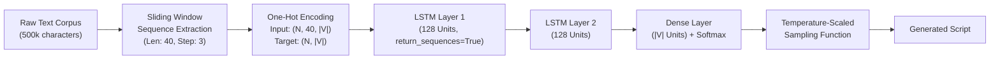

# 🎭 Character-Level Shakespearean Text Generator (LSTM / RNN)

[](https://www.python.org/)
[](https://www.tensorflow.org/)
[](https://keras.io/)
[](https://numpy.org/)

An autoregressive character-level language model trained on Shakespearean plays using **Recurrent Neural Networks (Stacked LSTM)**. The model learns linguistic syntax, poetic meter, vocabulary, character dialogue structure, and script formatting directly from raw characters without predefined grammar rules or external NLP tokenizers.

---

## 📌 Executive Summary

* **Task**: Character-level Autoregressive Sequence Modeling.
* **Architecture**: Multi-layer Stacked Long Short-Term Memory (LSTM) with Softmax classification.
* **Dataset**: Shakespeare corpus (~1.1M characters; 500,000 character training subset).
* **Sampling Engine**: Stochastic Temperature-Scaled Softmax sampling enabling controllable creativity vs. coherence trade-offs.
* **Output**: Fully autonomous generation of theatrical dialogue complete with speaker tags, archaic vocabulary, and poetic cadence.

---

## 🧠 Neural Architecture & Pipeline



### 1. Preprocessing & Feature Engineering
* **Tokenization**: Character-level mapping ($\approx 60\text{–}70$ unique character vocabulary $|V|$).
* **Sliding Window**: Extracts sequences of length $T = 40$ characters with a step stride $S = 3$, generating overlapping feature-target pairs $(X, y)$.
* **Vectorization**: Efficient Boolean 3D sparse tensors:
  $$\mathbf{X} \in \{0, 1\}^{N \times 40 \times |V|}, \quad \mathbf{y} \in \{0, 1\}^{N \times |V|}$$

### 2. Model Specification
* **Layer 1**: `LSTM(128, return_sequences=True)` — Captures low-level temporal representations across characters.
* **Layer 2**: `LSTM(128)` — Encodes higher-order word-level context and phrase syntax.
* **Output**: `Dense(|V|)` with `Softmax` activation.
* **Objective Function**: Categorical Cross-Entropy:
  $$\mathcal{L} = -\sum_{c \in V} y_c \log(\hat{y}_c)$$
* **Optimization**: `RMSprop(learning_rate=0.01)` with adaptive gradient scaling tailored for recurrent networks.

---

## 🌡️ Temperature-Scaled Sampling

To prevent repetitive, deterministic loops (greedy search) or incomprehensible gibberish (pure uniform noise), next-character selection uses **temperature scaling** over the model's logit distribution:

$$P(c_i) = \frac{\exp\left(\frac{\ln(\hat{y}_i)}{T}\right)}{\sum_j \exp\left(\frac{\ln(\hat{y}_j)}{T}\right)}$$

| Temperature ($T$) | Behavior | Use Case |
| :--- | :--- | :--- |
| **0.2** | Highly conservative, high certainty; repetitive. | Strict grammar checking / factual phrases. |
| **0.4 – 0.6** | **Optimal Sweet Spot**: Coherent prose, poetic meter, rich vocabulary. | Creative writing, script generation. |
| **0.8 – 1.0** | High entropy / risk; creative but risks spelling artifacts. | Novelty generation / abstract dialogue. |

---

## 📊 Sample Outputs by Temperature

### 🔹 Temperature: `0.4` (Coherent Dialogue & Dramatic Tension)
```text
e and our peers are both misled,
our treason of not not thou thou hast sould!

autolycus:
the bend and the warthing to his deash,
and thou was the great thou of your true,
and so the do you of the true for thou hast sound.

polixenem:
the grounds the torcher to me the word this eeds
with the king and see the true the sed the word to me.
```

### 🔹 Temperature: `0.6` (Multi-character Script Dynamics)
```text
ster:
and warwick, doing what you gave it i not
of the way, and whose sone in the mornon
the father winds in the death, nor had hardy.
we concege of you would with his life,
the comes the blood a brother do murder soul?

friar laurence:
of thou great make my leave the will of and you and should stand.
```

---

## 📂 Project Directory Structure

```text
├── main.py                 # End-to-end training pipeline & text generator
├── textgenerator.keras     # Serialized model artifact (Keras 3 format)
├── OUTPUT.md               # Generation benchmarks across temperature spectrum
├── requirements.txt        # Reproducible environment dependencies
└── README.md               # Project documentation
```

---

## 🚀 Quickstart & Reproduction

### Prerequisites
* Python 3.10 to 3.12
* Git

### Installation
```bash
# Clone the repository
git clone https://github.com/iam-dev-Adarsh/python-ai-projects.git
cd python-ai-projects

# Create and activate virtual environment
python -m venv venv
# On Windows:
.\venv\Scripts\Activate.ps1
# On macOS/Linux:
source venv/bin/activate

# Install dependencies
pip install tensorflow numpy
```

### Execution
To run the text generation using the pre-trained `.keras` model:
```bash
python main.py
```
*(Toggle `TRAIN_MODEL = True` inside `main.py` if you wish to retrain from scratch).*

---

## 🛠️ Technical Competencies Demonstrated

* **Deep Learning & Sequence Modeling**: LSTM memory cell mechanisms, vanishing gradient handling, sequence-to-one mapping.
* **Probability & Information Theory**: Multinomial distributions, temperature calibration, entropy control.
* **Modern MLOps & Frameworks**: TensorFlow 2.x, Keras 3 format serialization (`.keras`), tensor slicing and NumPy matrix manipulation.
* **Clean Code & Reproducibility**: Production-grade project formatting and modular design.

---

## 👨‍💻 Author

**Adarsh Singh**  
* GitHub: [@iam-dev-Adarsh](https://github.com/iam-dev-Adarsh)  
* Email: [iamvoid03@gmail.com](mailto:iamvoid03@gmail.com)