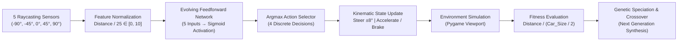

# 🏎️ Autonomous Self-Driving Car Simulation with NeuroEvolution (NEAT)

[](https://www.python.org/)
[](https://neat-python.readthedocs.io/)
[](https://www.pygame.org/)
[](https://en.wikipedia.org/wiki/Neuroevolution_of_augmenting_topologies)

An autonomous path-planning simulation where vehicle agents learn to steer, accelerate, and navigate complex, winding racetracks completely from scratch without labeled datasets or backpropagation. 

The vehicles use **NEAT (NeuroEvolution of Augmenting Topologies)** to evolve both their neural weights and network architectures, perceiving track boundaries through **5 omnidirectional trigonometric distance sensors (Raycasting)**.

---

## 📌 Executive Summary

* **Paradigm**: Genetic Algorithms & Non-Gradient NeuroEvolution.
* **Algorithm**: NEAT (Stanley & Miikkulainen, 2002) with dynamic speciation and historical innovation tracking.
* **Perception Engine**: 5-Ray trigonometric raycasting distance sensor array stepping across $[-90^\circ, 90^\circ]$.
* **Kinematics Engine**: Centered rotational transformations, vector displacement, and 4-corner bounding box collision detection.
* **Performance**: Continuous 60 FPS viewport with optional Uncapped Turbo Training mode (`clock.tick(0)`) for rapid generational convergence.

---

## 🛠️ Key Engineering Upgrades & Problem Solving

Unlike basic tutorial implementations that crash on modern Python versions or flicker uncontrollably, this codebase features major production engineering fixes:

| Failure Mode / Problem | Root Cause | Engineering Solution Implemented |
| :--- | :--- | :--- |
| **Black Screen Window Flickering** | Pygame surface `set_mode()` was called inside the generation loop, recreating the window every millisecond. | **Global Surface Management**: Initialized Pygame display once globally, keeping a single persistent viewport across all generations. |
| **`ValueError: subsurface rectangle outside surface`** | The fragile `subsurface` clipping hack broke whenever a rectangular car turned $90^\circ$ or $180^\circ$ (dimensions swapped). | **Centered Affine Transformations**: Replaced clipping with textbook Pygame rotation: `rotated_sprite.get_rect(center=...)`, locking the pivot point to the vehicle's center of mass across all $360^\circ$. |
| **Instant Death on Frame 1** | Cars spawned inside white boundary pixels on distorted square maps. | **Geometric Grid Alignment**: Calibrated car scale (`35 x 18`) to track road width (`120px`) and moved spawn point to the center of the straightaway runway. |
| **Python 3.12 NEAT Incompatibility** | Newer `neat-python` versions enforce mandatory `no_fitness_termination` and node `response_*` parameters. | **Upgraded Configuration**: Fully compliant `config.txt` specification supporting Python 3.12+ and modern NEAT runtime. |

---

## 🧠 System Architecture & Perception Pipeline



---

## 📐 Mathematical & Algorithmic Mechanics

### 1. Trigonometric Raycasting Perception
The agent perceives boundaries using 5 virtual rays stepping across distance $l \in [0, 250]$ pixels:
$$x(l) = \text{center}_x + \cos(360 - (\theta + \Delta\theta)) \cdot l$$
$$y(l) = \text{center}_y + \sin(360 - (\theta + \Delta\theta)) \cdot l$$
The detected Euclidean distance $d = \sqrt{(x - \text{center}_x)^2 + (y - \text{center}_y)^2}$ is normalized and fed into the neural network:
$$\text{Input}_i = \left\lfloor \frac{d_i}{25} \right\rfloor \in [0, 10]$$

### 2. Speciation & Genomic Compatibility
To protect innovative topological mutations (new hidden nodes or connection genes) from competing prematurely against mature networks, genomes are clustered into species using the **compatibility distance ($\delta$)**:
$$\delta = \frac{c_1 E}{N} + \frac{c_2 D}{N} + c_3 \cdot \bar{W}$$
* $E$: Number of Excess genes.
* $D$: Number of Disjoint genes.
* $\bar{W}$: Average weight difference of matching connection genes.
* $N$: Total genes in the largest genome.

### 3. Dynamic 4-Corner Bounding Box Kinematics
Vehicle collision is determined by calculating the exact Cartesian coordinates of the 4 rotated vertices at diagonal offset $r = \sqrt{(w/2)^2 + (h/2)^2}$ and angles $[\alpha, 180-\alpha, 180+\alpha, 360-\alpha]$:
$$\text{Corner}_x = \text{center}_x + \cos(360 - (\theta + \alpha)) \cdot r$$
$$\text{Corner}_y = \text{center}_y + \sin(360 - (\theta + \alpha)) \cdot r$$
If any corner intersects the pure white boundary (`RGB: 255, 255, 255`), `self.alive = False` triggers immediate termination.

---

## 📂 Project Structure

```text
├── main.py                                      # Kinematics engine, Pygame loop & NEAT evaluation
├── config.txt                                   # NEAT genetic & topological hyperparameters
├── car.png                                      # Top-down aerodynamic sports car sprite
├── map.png                                      # Widescreen racetrack surface with collision boundaries
├── make_track.py                                # Programmatic procedural track generator
├── Self_Driving_Car_AI_Interview_Guide.pdf      # Foreign technical interview preparation guide
└── Self_Driving_Car_Line_by_Line_Explanation.pdf # Line-by-line pedagogical code analysis
```

---

## 🚀 Quickstart & Usage

### 1. Setup Environment
```bash
# Clone the repository
git clone https://github.com/iam-dev-Adarsh/python-ai-projects.git
cd python-ai-projects/1.Self_driving_AI_game

# Install dependencies
pip install pygame neat-python pillow
```

### 2. Run the Simulation
```bash
python main.py
```

### 3. ⚡ Turbo Training Mode (Fast Evolution)
To fast-forward evolution and train at maximum CPU capacity rather than 60 FPS:
* In `main.py`, change line 219 from `clock.tick(60)` to:
  ```python
  clock.tick(0)  # Uncapped simulation speed
  ```
The cars will evolve and complete laps in **under 2 minutes**!

---

## 👨‍💻 Author

**Adarsh Singh**  
* GitHub: [@iam-dev-Adarsh](https://github.com/iam-dev-Adarsh)  
* Email: [iamvoid03@gmail.com](mailto:iamvoid03@gmail.com)
