# 🏎️ Autonomous Self-Driving Car Simulation with NeuroEvolution (NEAT)

[](https://www.python.org/)
[](https://neat-python.readthedocs.io/)
[](https://www.pygame.org/)

An autonomous path-planning simulation where vehicle agents learn to navigate complex, winding racetracks from scratch without labeled datasets or backpropagation. The agents use **NEAT (NeuroEvolution of Augmenting Topologies)** to evolve both their neural network weights and topologies, perceiving their environment through **5 omnidirectional trigonometric distance sensors (Raycasting)**.

---

## 📌 Executive Summary

* **Paradigm**: Genetic Algorithms & Non-Gradient NeuroEvolution.
* **Algorithm**: NEAT (Stanley & Miikkulainen, 2002) with dynamic speciation.
* **Perception Engine**: 5-Ray trigonometric raycasting distance sensor array spanning $[-90^\circ, 90^\circ]$.
* **Physics & Kinematics**: Centered rotational transformations, vector displacement, and 4-corner bounding box collision detection.
* **Output**: Fully autonomous obstacle avoidance, cornering, and high-speed throttle modulation.

---

## 🧠 System Architecture & Perception Pipeline

```mermaid
flowchart LR
    A["5 Raycasting Sensors<br>(-90°, -45°, 0°, 45°, 90°)"] --> B["Feature Normalization<br>Distance / 30 ∈ [0, 10]"]
    B --> C["Evolving Feedforward Network<br>(5 Inputs → Sigmoid)"]
    C --> D["Argmax Action Selector<br>(4 Output Decisions)"]
    D --> E["Vehicle Kinematics<br>Turn Left / Right / Accelerate / Brake"]
    E --> F["Environment Simulation<br>(Pygame 60 FPS)"]
    F --> G["Fitness Evaluation<br>Distance / (Car_Size / 2)"]
    G --> H["Genetic Speciation & Crossover<br>(Next Generation)"]
```



---

## 📐 Mathematical & Engineering Mechanics

### 1. Trigonometric Raycasting Perception
The agent perceives boundaries using 5 virtual rays stepping across distance $l \in [0, 300]$ pixels:
$$x(l) = \text{center}_x + \cos(360 - (\theta + \Delta\theta)) \cdot l$$
$$y(l) = \text{center}_y + \sin(360 - (\theta + \Delta\theta)) \cdot l$$
The detected Euclidean distance $d = \sqrt{(x - \text{center}_x)^2 + (y - \text{center}_y)^2}$ is normalized and fed into the neural network.

### 2. Speciation & Genomic Compatibility
To protect innovative topological mutations (new nodes/connections) from competing with mature networks, genomes are clustered into species using the **compatibility distance ($\delta$)**:
$$\delta = \frac{c_1 E}{N} + \frac{c_2 D}{N} + c_3 \cdot \bar{W}$$
* $E$: Number of Excess genes.
* $D$: Number of Disjoint genes.
* $\bar{W}$: Average weight difference of matching connection genes.
* $N$: Total genes in the largest genome.

### 3. Fitness Formulation & Anti-Gaming Logic
Agents receive incremental fitness for forward distance traversed:
$$\text{Reward} = \frac{\text{Distance}}{\text{CAR\_SIZE\_X} / 2}$$
An episode timeout ceiling ($1,200$ frames) prevents stagnant agents from farming fitness by driving in tight circles.

---

## 📂 Project Structure

```text
├── main.py                                      # Simulation engine, kinematics & NEAT execution
├── config.txt                                   # NEAT genetic & topological hyperparameters
├── car.png                                      # Top-down vehicle sprite
├── map.png                                      # Racetrack surface with collision boundaries
├── Self_Driving_Car_AI_Interview_Guide.pdf      # Foreign technical interview preparation guide
└── Self_Driving_Car_Line_by_Line_Explanation.pdf # Line-by-line pedagogical code analysis
```

---

## 🚀 Quickstart & Reproduction

### 1. Setup Environment
```bash
# Clone the repository
git clone https://github.com/iam-dev-Adarsh/python-ai-projects.git
cd python-ai-projects/2.Self_Driving_Car_AI

# Install dependencies
pip install pygame neat-python
```

### 2. Run the Simulation
```bash
python main.py
```
* **Generation 1–3**: Random exploration; most cars crash on the first corner.
* **Generation 4–7**: Emergence of braking and turning behavior around sharp curves.
* **Generation 8+**: Elite agents master the track, drifting cleanly through the full circuit.

---

## 👨‍💻 Author

**Adarsh Singh**  
* GitHub: [@iam-dev-Adarsh](https://github.com/iam-dev-Adarsh)  
* Email: [iamvoid03@gmail.com](mailto:iamvoid03@gmail.com)